# 🗺️ НАВИГАЦИОННАЯ КАРТА ПРОЕКТА ДЛЯ ИИ (AI_MAP.md)

> **Назначение документа:** Единый индекс репозитория `CyberBullingConcept` («Сыгравший в ящик» / «Хроники Плейбокса»).  
> **Инструкция для ИИ-агентов:** Перед началом поиска по диску прочитайте этот файл. Он содержит точные пути ко всем активным материалам, инструментам, данным и правилам проекта. **НЕ сканируйте весь репозиторий повторно.**

---

## 🏛️ Архитектура репозитория

```mermaid
graph TD
    Root["CyberBullingConcept (Root)"] --> Docs["docs/ (Тексты, сценарии, лор)"]
    Root --> Media["media/ (Все медиа-ресурсы)"]
    Root --> Tools["tools/ (Скрипты и пайплайны)"]
    Root --> Data["data/ (Тяжелые датасеты JSON)"]
    Root --> WebAssets["web_assets/ (Фронтенд-ассеты презентации)"]
    Root --> Scratch["scratch/ (Временные файлы и черновики)"]

    Docs --> Golden["docs/golden/ (ЭТАЛОННЫЕ ВЕРСИИ)"]
    Docs --> Archive["docs/archive_versions/ (Архив версий V1-V12)"]
    Docs --> LoreConcepts["docs/lore_concepts/ (WH40K концепты, синопсис)"]
    Docs --> LyricsRoasts["docs/lyrics_and_roasts/ (Рэп, шутки, шаблоны)"]
    Docs --> ResearchFacts["docs/research_facts/ (Факты Толи, встречи)"]

    Media --> MediaAudio["media/audio/ (Озвучка V13, треки, эмбиент)"]
    Media --> MediaVisual["media/visual/ (Midjourney, Imagen, слои, аватарки)"]
    Media --> MediaSlack["media/slack_screenshots/ (Скриншоты Slack)"]

    Tools --> StudioTools["tools/studio/ (Co-Writer & Joke Keeper)"]
    Tools --> AudioTools["tools/audio_pipeline/ (Генерация озвучки)"]
    Tools --> VisualTools["tools/visual_pipeline/ (Эмблемы, персонажи)"]
    Tools --> SlackTools["tools/slack_capture/ (Утилиты захвата Slack)"]
    Tools --> FactTools["tools/fact_analyzer/ (Анализ фактов)"]
```

---

## ⚡ Экспресс-навигатор (Золотые источники / Single Source of Truth)

| Что нужно найти | Точный путь к файлу | Описание |
| :--- | :--- | :--- |
| 📜 **Финальный сценарий хроник** | `docs/golden/VOICES_OF_PRODUCTION_GOLDEN.md` | Эталонная версия V13 («Хроники Продакшен-Ковчега», 7 актов + пролог). |
| 🎤 **Текст рэп-трека ИИ-Лорда** | `docs/golden/AI_LORD_RAP_TRACK.md` | Актуальный мастер-текст трека ИИ-Лорда («Сервоторизация приматов»). |
| ⚖️ **Правила и принципы лора** | `docs/golden/LORE_RULES_AND_PRINCIPLES.md` | 14 золотых правил сеттинга, баланс иронии, стилистика WH40K. |
| 👥 **Ростер персонажей** | `docs/golden/CHARACTERS_ROSTER_V2.md` | Досье ключевых лиц продакшена, их роли и архетипы. |
| 🎨 **Визуальное досье персонажей**| `docs/golden/WARHAMMER_CHARACTERS_VISUAL_DOSSIER.md` | Описания внешности в эстетике Warhammer, униформа, детали. |
| 🖼️ **Промпты для Midjourney** | `docs/golden/CHARACTERS_MIDJOURNEY_PROMPTS.md` | Базовые промпты генерации персонажей. |
| 🎞️ **Ретро-кино стиль персонажей** | `docs/golden/RETRO_SOVIET_FILM_CHARACTER_STYLE_GUIDE.md` | Как генерировать персонажей через GPT Image API в стиле старой советской/американской фантастики: practical effects, 35mm, павильон, костюмы, запреты на рисованный concept art. |
| 🎙️ **Финальная озвучка V13 (полная)**| `media/audio/voiceover_v13/voices_of_production_v13_cinematic.mp3` | Полная дорожка с кинематик-эмбиентом. |
| 🎙️ **Чистая озвучка по актам (Dry Voice)**| `Озвучка/` и `media/audio/voiceover_v13/` | 100% чистый дикторский голос Geremy (`00_` полная версия 15:53 + `01_`–`08_` поактовые треки без музыки). |
| 🎵 **Мастер-трек ИИ-Лорда** | `media/audio/tracks/Сервоторизация_приматов_HD_WSOLA_TimeDomain.mp3` | Финальная мастер-версия песни ИИ-Лорда. |
| 🌐 **Веб-презентация проекта** | `index.html` (в корне) | Интерактивный плеер презентации «Сыгравший в ящик». Запуск: `OPEN_PRESENTATION.bat`. |

---

## 📁 Подробный каталог папок

### 1. `docs/` — Текстовая база, драматургия и правила
- **`docs/golden/`**: Только утверждённые мастер-версии текстов.
- **`docs/archive_versions/`**: Исторические версии сценариев `VOICES_OF_PRODUCTION.md`, `VOICES_OF_PRODUCTION_V2.md` ... `V12.md`, а также старые бэкапы правил.
- **`docs/lore_concepts/`**:
  - `SPACESHIP_STORY_SYNOPSIS.md`: Синопсис Ковчега.
  - `PLAYBOX_RUSSIAN_WARHAMMER_VARIANTS.md`: Локализация терминов WH40K.
  - `PLAYBOX_SHIP_NAMES_WH40K.md`: Варианты названий кораблей.
  - `WARHAMMER_FATES_BOX_VARIANTS.md`: Концепции «Сыгравшего в ящик».
  - `COMPACT_CONTEXT.md`: Сжатый контекст лора для промптов.
- **`docs/lyrics_and_roasts/`**:
  - `EXAMPLE_ROAST_ISSUE_13.md`, `ROAST_DRAFT_TEMPLATE.md`: Шаблоны прожарок.
  - `REFERENCE_PROJECT_MANAGER_LYRICS.md`: Референсы стихов и рэпа.
  - `Удачные идеи.txt`: Зафиксированные панчи и удачные формулировки.
- **`docs/research_facts/`**:
  - Исходные факты встреч и Slack за сентябрь–октябрь (файлы от Толи).
  - `song_facts_mapped.md`: Карта соответствия фактов строкам песни.

---

### 2. `media/` — Аудио, графика, видео и скриншоты
- **`media/audio/`**:
  - `voiceover_v13/`: Поактовые дорожки `01_act_1_intro.mp3` ... `07_act_7_outro.mp3`, мастер-дорожки, списки склейки (`concat_list.txt`) и русскоязычный `README.md`.
  - `tracks/`: Сгенерированные треки («Сервоторизация приматов», «Чистый Плейриум», партитуры `cinematic_dark_score.wav`, `dark_ambient_citadel.wav`).
  - `ambient/`: Эмбиент-лупы 90с, вокализы, стемы.
  - `snippets_and_tests/`: Нарезки и эксперименты с питчем/формантами.
- **`media/visual/`**:
  - `midjourney/`: Сгенерированные концепты Midjourney (также доступна по алиасу `assets/midjourney`).
  - `imagen/`: Генерации Google Imagen (доступна по алиасу `assets/imagen`).
  - `characters/avatars/`: Реальные аватарки сотрудников.
  - `characters/real/`: Референсные фото.
  - `ai_lord/`: Образы ИИ-Лорда на троне, с бас-гитарой и дубинкой.
  - `generated/`: Прочие арты и PSD-макеты («Лого сыгравший в ящик.psd» и др.).
  - `layers/`: Нарезанные по слоям кадры империума (00_Фон ... 21).
  - `chronicle_screens/`: Скриншоты видеоряда (screen_00 ... screen_21).
  - `prompts/`: 74 файла промптов и метаданных для визуализаций.
  - `frames/`: Отдельные ключевые видеокадры (`frame_10m.jpg` и др.).
- **`media/slack_screenshots/`**:
  - `final/`: 16 готовых отрендеренных скриншотов реальных сообщений из Slack (доступна по алиасу `Slack_Screenshots`).
  - `raw_tests/`: Черновые скриншоты и тесты кликов.
  - `brand_style/`: Скриншоты фирменного стиля Playbox.
- **`web_assets/`** *(в корне)*:
  - Специальный бандл для `index.html` (`web_assets/images`, `web_assets/audio`, `web_assets/video`). Не перемещается во избежание разрыва относительных путей плеера.

---

### 3. `tools/` — Исполняемые скрипты, утилиты и студии
- **`tools/studio/`**:
  - `co_writer_studio.html`: Веб-студия соавтора текста трека.
  - `joke_keeper_studio.html`: Студия сохранения и категоризации шуток.
  - `studio_server.py`: Сервер на порту `8765` (REST API для студий, автосохранение в `docs/golden/`, бэкапы).
  - `backups/`: Чекпоинты версий трека (`checkpoints_index.json`).
- **`tools/audio_pipeline/`**:
  - `generate_full_chronicles_v13.py`: Полная сборка кинематик-выпуска V13.
  - `update_voiceover_v13_golden.py`: Обновление мастер-дорожек.
  - `generate_voiceover.py`: Генератор озвучки через ElevenLabs API.
  - `generate_cinematic_score.py`, `generate_dark_ambient.py`: Генерация музыки.
  - `separate_ambient.py`, `restore_female_vocal.py`: Разделение дорожек и реставрация.
- **`tools/visual_pipeline/`** *(также доступна по алиасу `scripts`)*:
  - `create_playbox_skull_chest_emblem.py`: Генерация векторной эмблемы черепа.
  - `create_playbox_skull_emblem_from_sketch.py`: Обработка скетча логотипа.
  - `generate_all_characters.ps1`: Пакетная генерация персонажей.
- **`tools/slack_capture/`**:
  - `SlackCapture.exe`, `SlackCapture.cs`, `SlackContextCapture.exe`, `SlackContextCapture.cs`: C#-утилиты снятия скриншотов Slack.
  - `Capture.ps1`, `open_in_context.ps1`, `run_batch_capture.ps1`: Сценарии захвата.
  - `render_slack_screenshots.py`: Рендеринг финальных картинок.
- **`tools/fact_analyzer/`**:
  - Скрипты анализа и поиска фактов: `parse_all_facts.py`, `search_facts.py`, `find_exact_context_slices.py`, `verify_all_events.py` и др.
- **`tools/yt_transcripts/`**:
  - Утилиты загрузки и процессинга субтитров YouTube (`download_transcripts.py`, `process_transcripts.py`).

---

### 4. `data/` — Базы данных и тяжелые датасеты
- **`data/facts_dataset/`**:
  - `found_facts_summary.json` (2.1 MB)
  - `search_results.txt` (2.1 MB)
  - `all_song_context_slices.json`, `verified_context_slices.json`, `extracted_song_permalinks.json`.
- **`data/joke_keeper/`**:
  - `joke_keeper_data.json`: База шуток и прожарок.

---

### 5. `scratch/` — Черновики и временные данные
- Служебные временные файлы, промежуточные `.wav` и `.mp3` сведения, маски инпеинтинга (`masks/`), заметки (`scratch_notes/`).
- Не индексируется для продакшена.

---

## 🔗 Символические ссылки и обратная совместимость (NTFS Junctions)

Для гарантии того, что старые скрипты, интеграции и правила Midjourney не сломаются, настроены прозрачные системные связки:
1. `assets/midjourney` ➔ `media/visual/midjourney` (требование правила `Midjourney-Integration.md`).
2. `assets/voiceover_v13` ➔ `media/audio/voiceover_v13` (для `generate_full_chronicles_v13.py`).
3. `assets/imagen` ➔ `media/visual/imagen`.
4. `Slack_Screenshots` ➔ `media/slack_screenshots/final` (для `render_slack_screenshots.py`).
5. `Визуал` ➔ `media/visual` (для совместимости со скриптами эмблем).
6. `scripts` ➔ `tools/visual_pipeline`.

---

## 🛑 Правила для ИИ-агентов при создании новых файлов

1. **Новые тексты сценария/песен:**
   - Если это финальная утверждённая версия — сохраняйте в `docs/golden/`.
   - Если черновик/вариант — сохраняйте в `docs/archive_versions/` или `scratch/`.
   - **НИКОГДА не сохраняйте новые текстовые файлы в корень проекта.**
2. **Новые генерации картинок Midjourney:**
   - Сохраняйте в `media/visual/midjourney/` (или по алиасу `assets/midjourney/`).
3. **Новые скрипты:**
   - Размещайте строго в соответствующую подпапку внутри `tools/` (`audio_pipeline`, `visual_pipeline`, `slack_capture`, `fact_analyzer`).
4. **Тяжелые JSON/TXT базы (свыше 50 КБ):**
   - Размещайте в `data/` или `scratch/`, не засоряя папки документов.
