# 🗺️ НАВИГАЦИОННАЯ КАРТА ПРОЕКТА ДЛЯ ИИ (AI_MAP.md)

> **Назначение документа:** Единый индекс репозитория `CyberBullingConcept` («Сыгравший в ящик» / «Хроники Плейбокса»).  
> **Инструкция для ИИ-агентов:** Перед началом поиска по диску прочитайте этот файл. Он содержит точные пути ко всем активным материалам, инструментам, данным и правилам проекта. **НЕ сканируйте весь репозиторий повторно.**

---

## 🏛️ Архитектура репозитория

```mermaid
graph TD
    Root["CyberBullingConcept (Root)"] --> Docs["docs/ (Тексты, сценарии, лор)"]
    Root --> Media["media/ (Все медиа-ресурсы)"]
    Root --> Tools["tools/ (Скрипты и пайплайны)"]
    Root --> Data["data/ (Тяжелые датасеты JSON)"]
    Root --> WebAssets["web_assets/ (Фронтенд-ассеты презентации)"]
    Root --> Scratch["scratch/ (Временные файлы и черновики)"]

    Docs --> Golden["docs/golden/ (ЭТАЛОННЫЕ ВЕРСИИ)"]
    Docs --> Archive["docs/archive_versions/ (Архив версий V1-V12)"]
    Docs --> LoreConcepts["docs/lore_concepts/ (WH40K концепты, синопсис)"]
    Docs --> LyricsRoasts["docs/lyrics_and_roasts/ (Рэп, шутки, шаблоны)"]
    Docs --> ResearchFacts["docs/research_facts/ (Факты Толи, встречи)"]

    Media --> MediaAudio["media/audio/ (Озвучка V13, треки, эмбиент)"]
    Media --> MediaVisual["media/visual/ (Midjourney, Imagen, слои, аватарки)"]
    Media --> MediaSlack["media/slack_screenshots/ (Скриншоты Slack)"]

    Tools --> StudioTools["tools/studio/ (Co-Writer & Joke Keeper)"]
    Tools --> AudioTools["tools/audio_pipeline/ (Генерация озвучки)"]
    Tools --> VisualTools["tools/visual_pipeline/ (Эмблемы, персонажи)"]
    Tools --> SlackTools["tools/slack_capture/ (Утилиты захвата Slack)"]
    Tools --> FactTools["tools/fact_analyzer/ (Анализ фактов)"]
```

---

## ⚡ Экспресс-навигатор (Золотые источники / Single Source of Truth)

| Что нужно найти | Точный путь к файлу | Описание |
| :--- | :--- | :--- |
| 📜 **Финальный сценарий хроник** | `docs/golden/VOICES_OF_PRODUCTION_GOLDEN.md` | Эталонная версия V13 («Хроники Продакшен-Ковчега», 7 актов + пролог). |
| ✍️ **Актуальная версия Guardians** | `docs/guardians_edition/VOICES_OF_PRODUCTION_V15_GUARDIANS.md` | Редакция V15: структура пяти функциональных залов Толи под сквозную ось Ковчега (*Сборочный Алтарь → Хроно-отсек → Трюм Очищения → Шлюз Клиентархов → Штурм Стены*), One Story Rule (по 2 героя), стандарт экранных карточек Guardians и терминальная Домашка (COO). Режиссёрская версия со сценарно-движковой разметкой: `docs/guardians_edition/VOICES_OF_PRODUCTION_V15_1_GUARDIANS.md`. |
| 😈 **Проектные рецепты юмора** | `F:/AI/Skills/04_Writing/cyberbulling-humor/SKILL.md` | Наши проверенные приёмы, одобренные формулировки и выводы из ошибок для «Кибербуллинга». Общая учебная база — отдельно в `humor-writing`; каталог: `references/approved-recipes.md`. |
| 🎲 **Создание сценарных интерактивов** | `F:/AI/Skills/04_Writing/cyberbulling-interactives/SKILL.md` | Вопросы-трейлеры, выбор факта, телеигровые форматы, игровые ветки и немедленный переход к связанной истории. Для полировки реплик использует общий `text-punchup`; постановка — через `cyberbulling-director`. |
| ✂️ **Общая редактура текста и игровых реплик** | `F:/AI/Skills/04_Writing/text-punchup/SKILL.md` | Одна система для повествования и интерактивов: знания зрителя, мотивы, смысловая точность и панч-ап. Выводы из замечаний 17.11.2026: `references/context-and-logic.md`; принятые примеры хранятся в `cyberbulling-humor`. |
| ✍️ **Co-Writer внутри AI Control Hub** | `F:\AI\AI_Control_Hub_Portable\AI_Control_Hub.exe` | Раздел «Co-Writer · Тексты»: .md/.txt, Ctrl+S, черновики, правила стиля и просмотр правок ИИ. В окне правки — Авто / GPT / Gemini Delegate / Antigravity / Claude и выбор модели; состояние подключений — `cowriter.ai.options`. Запуск: `--cowriter <абсолютный путь>`. Исходники: `F:\AI\AI_Control_Hub\`; последняя установка и проверки: `scratch/hub-context-providers-20261115/README.md`. |
| 🤖 **CLI / MCP хаба для любого ИИ** | `F:\AI\AI_Control_Hub_Portable\AgentTools\hub.py` | `status` — живое состояние, `help` — JSON-схемы 31 команды, `mcp` — MCP stdio. Использовать вместо кнопок и правки recovery-файлов. `cowriter.ai.options/route` проверяют доступность и подбор без генерации. Памятка: `F:\AI\AI_Control_Hub_Portable\AgentTools\README.md`; базовые проверки: `scratch/hub-agent-interface-20261114/README.md`. Кириллица stdin исправлена и проверена: `scratch/hub-utf8-20261115/README.md`. |
| 🤖 **Подключения моделей Co-Writer** | `cowriter.ai.options/route` через `hub.py` | Antigravity подключён через официальный `agy` и существующий аккаунт Google. GPT при запрете отдельного API передаёт задачу в текущий чат: `cowriter.ai.request.get/respond`, вариант возвращается в диалог без применения. Полный запрос виден в блоке «Контекст». Gemini Pro не подменяется на Flash. Прямое подключение Claude пока отложено пользователем. |
| 📌 **Постоянные правила Co-Writer** | `cowriter.rules.get/set/append/import` через `hub.py` | Панель справа, ручное редактирование и CLI/MCP, автосохранение. Для Guardians загружен `docs/guardians_edition/EDITORIAL_RULES.compact.md`; полный регламент сохранён отдельно. Кэшировать `hash`, затем читать `rules.get` с `ifHash`: неизменный текст повторно не возвращается. Встроенные запросы ИИ включают правила. |
| 🖍️ **Пометки текста в Co-Writer** | `cowriter.highlights.list/add/remove/clear` через `hub.py` | Приглушённая подсветка с комментариями, ручное добавление из выделения и удаление по одной, переходы и скрытие. ИИ добавляет пакет точных цитат с `expectedVersion`; проверить `editorVerified`. `clear` с `author: "ai"` сохраняет человеческие пометки. Установка, примеры и проверки: `scratch/hub-highlights-20261115/README.md`. |
| 🎤 **Текст рэп-трека ИИ-Лорда** | `docs/golden/AI_LORD_RAP_TRACK.md` | Актуальный мастер-текст трека ИИ-Лорда («Сервоторизация приматов»). |
| ⚖️ **Правила и принципы лора** | `docs/golden/LORE_RULES_AND_PRINCIPLES.md` | 14 золотых правил сеттинга, баланс иронии, стилистика WH40K. |
| 👥 **Ростер персонажей** | `docs/golden/CHARACTERS_ROSTER_V2.md` | Досье ключевых лиц продакшена, их роли и архетипы. |
| 🎨 **Визуальное досье персонажей**| `docs/golden/WARHAMMER_CHARACTERS_VISUAL_DOSSIER.md` | Описания внешности в эстетике Warhammer, униформа, детали. |
| 🖼️ **Промпты для Midjourney** | `docs/golden/CHARACTERS_MIDJOURNEY_PROMPTS.md` | Базовые промпты генерации персонажей. |
| 🎞️ **Ретро-кино стиль персонажей** | `docs/golden/RETRO_SOVIET_FILM_CHARACTER_STYLE_GUIDE.md` | Как генерировать персонажей через GPT Image API в стиле старой советской/американской фантастики: practical effects, 35mm, павильон, костюмы, запреты на рисованный concept art. |
| 🖼️ **Автономный протокол генерации (Zero-Touch)** | `F:\AI\00_CORE\RULES\Autonomous-Image-Pipeline.md` | 100% автономия генерации артов без участия пользователя, маршрутизация (Google Pro / OpenAI / Midjourney), авто-fallback при 429, запрет на сохранение в `Fin/`, формула Де-CGI, Dread Contrast. |
| 🎙️ **Финальная озвучка V13 (полная)**| `media/audio/voiceover_v13/voices_of_production_v13_cinematic.mp3` | Полная дорожка с кинематик-эмбиентом. |
| 🎙️ **Чистая озвучка по актам (Dry Voice)**| `Озвучка/` и `media/audio/voiceover_v13/` | 100% чистый дикторский голос Geremy (`00_` полная версия 15:53 + `01_`–`08_` поактовые треки без музыки). |
| 🎵 **Мастер-трек ИИ-Лорда** | `media/audio/tracks/Сервоторизация_приматов_HD_WSOLA_TimeDomain.mp3` | Финальная мастер-версия песни ИИ-Лорда. |
| 🌐 **Интерактивный фильм (PixiJS)** | `repo/` (исходники) и `repo/dist/` | Флагманский интерактивный фильм. Запуск: `OPEN_INTERACTIVE_MOVIE.bat`. |
| 🎞️ **Две версии фильма в презентации** | `index.html#playable-area` | Переключатель: текущая **v2.0** — `game.html` и предыдущая **v1.0** — неизменная `game-previous.html` из `655ba3e`. Номера сборок сайта независимы от сценариев V15 / V15.1. Подробности: `docs/guardians_edition/MOVIE_BUILD_VERSIONS.md`. Локальный сервер с перемоткой: `START_PRESENTATION_SERVER.bat` или `python tools/interactive/serve_presentation.py --port 8876`. |
| 🎮 **Контент интерактива: телеигры** | `media/interactive/` | 146 проверенных MP3 для «Поля чудес», «Миллионера» и ЧГК; скриншоты, прозрачные PNG, SVG, источники и локальный каталог `index.html`. «Поле чудес» с 16.11.2026: классические синие квадраты с серебристой рамкой, белые буквы, референс с Якубовичем. Генераторы: `tools/interactive/`. |
| 📝 **Единый сценарный формат телеигр** | `docs/guardians_edition/INTERACTIVE_SCRIPT_STANDARD.md` | Применён в V15: перед каждым из пяти залов — тема и шутка передачи слова Толе → живой блок → «Продолжить» → игра → комната. Порядок: Миллионер / Поле / ЧГК / Миллионер / Поле. Все реплики и ответы теперь в самом V15; монтаж пяти остановок ещё предстоит. |
| 📝 **Две оставшиеся игры интегрированы, 18.11** | `docs/guardians_edition/VOICES_OF_PRODUCTION_V15_GUARDIANS.md` и `VOICES_OF_PRODUCTION_V15_1_GUARDIANS.md` | Перед IV — Househunt: один выбор, раскрытие всех четырёх удалённых действий, без ошибок. Перед V — ПУЛЗЫ: пять букв, три ошибки, полный банк реакций. Первые три игры сохранены; история 22 ГБ/«oops» возвращена в III, Househunt — после I-02. Сверка источников: `scratch/interactive-iv-v-20261118/HOUSEHUNT_MECHANICS_RESEARCH.md`. Проект `INTERACTIVE_IV_V_CLEAN.md` в той же папке — архивный снимок, не параллельный мастер. Плеер отдельно. |
| 🎮 **Интерактив перед третьим актом — в чистовом билде** | `game.html` (через `index.html`) | Короткий вопрос с контекстом Slack, восемь синих ячеек и ввод прямо в клетки. Одна буква или всё слово + Enter; верная буква перемещается на свои места. Озвучка Geremy, музыка раздумий по кругу, общее правило трёх ошибок и автоматический выход к сюжету. Шрифты и размеры из существующих объектов фильма; штатные нижние субтитры, CC, пауза и перемотка; отдельная проба — `media/interactive/protocol-preview/interactive-preview.html`. Подключена перед началом `act_3_timemachine`: сначала игра, затем акт с Горином и реплика с ответом; сценарий — `docs/guardians_edition/INTERACTIVE_PREACT_PROTOCOL.md`. Резерв до внедрения: GitHub-ветка `codex/checkpoint-before-word-quiz-20261117`, коммит `655ba3e`. |
| 🌐 **Веб-презентация проекта (GitHub Pages)** | `https://magic-quick.github.io/CyberBullingConcept/` | Публичная онлайн-презентация «Сыгравший в ящик». Репозиторий: `Magic-Quick/CyberBullingConcept`. Деплой: `tools/DEPLOY.bat`. |

---

## 🎬 Текущая редакция Guardians (согласовано 14.11.2026)

Новая редакция снижает порог входа в лор, сохраняя брутальный мир и производство Плейриума как цифрового наркотика. Короткие имена звучат в повествовании; полные канонические титулы сохраняются на экране. Представление человека: чистый портрет → имя и титул → голос с субтитрами.

| Материал | Путь | Статус |
| :--- | :--- | :--- |
| Рабочая версия хроник V14 | `docs/guardians_edition/VOICES_OF_PRODUCTION_V14_GUARDIANS.md` | Речь оригинального V13 без режиссёрских/визуальных/звуковых ремарок. |
| Режиссёрская версия V14.1 (связь с билдом) | `docs/guardians_edition/VOICES_OF_PRODUCTION_V14_1_GUARDIANS.md` | Версия V14.1 со сценарно-движковой разметкой билда: кадры `[КАДР]`, плашки Slack `[СЛАК]`, звук `[ЗВУК]`, титры `[ПЕРСОНАЖ]`. |
| Редакция Guardians V15 (канон Толи) | `docs/guardians_edition/VOICES_OF_PRODUCTION_V15_GUARDIANS.md` | Авторский источник произносимого текста V15: пять залов, пять передач слова Толе и полный банк ответов; сверенная режиссёрская версия — V15.1. |
| Режиссёрская редакция V15.1 (полная разметка) | `docs/guardians_edition/VOICES_OF_PRODUCTION_V15_1_GUARDIANS.md` | Сверенная режиссёрская V15.1: все 107 речевых блоков V15 и 18 дополнительных реакций, пять игр в порядке Миллионер / Поле / ЧГК / Миллионер / Поле. Передачи слова адресованы Толе; капча используется только в «Поле чудес», у остальных форматов собственные подводки. Первый «Миллионер» — восстановление просьбы Эдика о звуке; после обоих исходов сразу идёт перенесённая история сундука. Одобренные реакции на «яйцо» и «стыдно» записаны дословно. Музыка, тишина и сигналы размечены по событиям; спойлерные показы и повтор разгадки убраны. Это сценарий, не подтверждение переноса в плеер. |
| Музыкальная партитура V15.1 | `docs/guardians_edition/V15_1_MUSIC_CUE_SHEET.md` | Все 155 музыкальных/SFX cue с файлами и условиями входа, приглушения и остановки. Машинная ведомость: `data/director/v15_1_music_cues.json`. |
| Резерв одобренных интерактивных шуток | `docs/guardians_edition/INTERACTIVE_JOKE_RESERVE.md` | Отложенная реплика про кислород сохранена по просьбе пользователя для другого отсека; в текущий ЧГК не вставлять. |
| Согласованные редакционные правила | `docs/guardians_edition/EDITORIAL_RULES.md` | Читать перед работой над Guardians: фантастический сюжет, титулы, Клиентархи / Supercell, отдельные каналы голоса и текста. |
| Компакт правил для проходов ИИ | `docs/guardians_edition/EDITORIAL_RULES.compact.md` | Рабочая сводка в панели Co-Writer; полный регламент остаётся источником подробностей. Текущий режим — анализ и пометки, сохранение оригинального текста для озвучки. |
| План Co-Writer и интерактивного фильма | `docs/guardians_edition/APP_CHANGE_PLAN.md` | План изменений; фиксация документа не означает реализацию приложения. |
| Сверка билда с V15.1 и план синхронизации, 18.11 | `docs/guardians_edition/BUILD_TEXT_SYNC_PLAN_20261118.md` | Исторический аудит старого билда и выполненный план переноса пяти остановок. Старый v2.0 сохранён как `game-v2-before-director.html`, v1.0 — `game-previous.html`. |
| Режиссёр хроник и рабочий текстовый мастер | `docs/guardians_edition/implementation/CHRONICLES_EDITOR.md` | Реализация 18.11: `repo/src/chronicles/default-project.md` — речь и единственный `chronicles-config`; 242 реплики, 28 сцен, 915 клипов, 5 остановок. `tools/OPEN_CHRONICLES_DIRECTOR.bat` — редактор на 8877 с Ctrl+S в файл, библиотекой, инспектором, дорожками и ветками. Адаптивная композиция и исходная карточка — `presentation.ts`, `presentation.css`, `CharacterBadge.ts`; layout/avatar/typewriter хранятся в конфиге. Исходная заставка — `MovieOpening.ts`, хоткеи — `viewerShortcuts.ts`, наклейки — `navigation` в мастере; регрессии проверены в `implementation/QA_20261118.md`. Код в `repo/src/chronicles/`, импорт/проверки/локальный сервер — `tools/chronicles/`. Исходный контракт: `DIRECTOR_MODE_SPEC.md`. |
| ⏸️ **Слово Толе и пять игровых вступлений V15** | `docs/guardians_edition/CHAPTER_HANDOFFS_TIMELINE.md` | Пять передач с темами и шутками стоят перед соответствующими залами; после живой речи Толи «Продолжить» запускает игру. Текст сохранён в V15 через Co-Writer; реализация всего маршрута в плеере отдельно. |
| Пример структуры сцены | `docs/guardians_edition/story_format.example.json` | Предложение формата с отдельными `voiceText`, `subtitleText`, карточками и таймингами; не производственный монтаж. |

---

## 📁 Подробный каталог папок

### 1. `docs/` — Текстовая база, драматургия и правила
- **`docs/golden/`**: Только утверждённые мастер-версии текстов.
- **`docs/archive_versions/`**: Исторические версии сценариев `VOICES_OF_PRODUCTION.md`, `VOICES_OF_PRODUCTION_V2.md` ... `V12.md`, а также старые бэкапы правил.
- **`docs/lore_concepts/`**:
  - `SPACESHIP_STORY_SYNOPSIS.md`: Синопсис Ковчега.
  - `PLAYBOX_RUSSIAN_WARHAMMER_VARIANTS.md`: Локализация терминов WH40K.
  - `PLAYBOX_SHIP_NAMES_WH40K.md`: Варианты названий кораблей.
  - `WARHAMMER_FATES_BOX_VARIANTS.md`: Концепции «Сыгравшего в ящик».
  - `COMPACT_CONTEXT.md`: Сжатый контекст лора для промптов.
- **`docs/lyrics_and_roasts/`**:
  - `EXAMPLE_ROAST_ISSUE_13.md`, `ROAST_DRAFT_TEMPLATE.md`: Шаблоны прожарок.
  - `REFERENCE_PROJECT_MANAGER_LYRICS.md`: Референсы стихов и рэпа.
  - `Удачные идеи.txt`: Зафиксированные панчи и удачные формулировки.
- **`docs/research_facts/`**:
  - Исходные факты встреч и Slack за сентябрь–октябрь (файлы от Толи).
  - `song_facts_mapped.md`: Карта соответствия фактов строкам песни.

---

### 2. `media/` — Аудио, графика, видео и скриншоты
- **`media/audio/`**:
  - `voiceover_v13/`: Поактовые дорожки `01_act_1_intro.mp3` ... `07_act_7_outro.mp3`, мастер-дорожки, списки склейки (`concat_list.txt`) и русскоязычный `README.md`.
  - `tracks/`: Сгенерированные треки («Сервоторизация приматов», «Чистый Плейриум», партитуры `cinematic_dark_score.wav`, `dark_ambient_citadel.wav`).
  - `ambient/`: Эмбиент-лупы 90с, вокализы, стемы.
  - `snippets_and_tests/`: Нарезки и эксперименты с питчем/формантами.
- **`media/visual/`**:
  - `midjourney/`: Сгенерированные концепты Midjourney (также доступна по алиасу `assets/midjourney`).
  - `imagen/`: Генерации Google Imagen (доступна по алиасу `assets/imagen`).
  - `characters/avatars/`: Реальные аватарки сотрудников.
  - `characters/real/`: Референсные фото.
  - `ai_lord/`: Образы ИИ-Лорда на троне, с бас-гитарой и дубинкой.
  - `generated/`: Сгенерированные арты, концепты и PSD-макеты.
    - `generated/Fin/`: **Эталонный фонд финальных утверждённых ассетов (Production Gold Assets)**:
      - `AILORD_fin/`: 9 эталонных кадров ИИ-Лорда (.png): грандиозный тронный зал на мостике (`retro_film_ai_lord_throne_room_grand_eyes_v6`), чтение хроник на троне, трибунал/награждение, крупные планы лица (canonical & gemini 1080p), макро глаз, скипетр-батон и печенька благодати.
      - `Concert_Fin/`: Секвенция рок-концерта ИИ-Лорда (крыло, POV толпы, драйв, соло на басу, руки).
      - `Story_Fin/`: 23 эталонных кинокадра сюжета, экстерьер Ковчега («Сыгравший в ящик»), саркофаг Mintegral.
      - `Team_Fin/`: 22 широкоформатных (16:9) кинематографичных портрета команды в стиле ретро-кино 80-х.
      - `Avatars_Fin/`: 21 квадратная аватарка участников команды (Slack-профили и hero-аватары).
      - `Slack_Fin/`: 19 чистовых скриншотов сообщений из Slack (включая все 4 опечатки Горина).
      - `Gui_Fin/`: 44 текстуры винтажного лампово-аналогового интерфейса плеера (кнопки, ручки, шасси, индикаторы, стикеры, логотипы игры и черепа Playbox).
  - `layers/`: Нарезанные по слоям кадры империума (00_Фон ... 21).
  - `chronicle_screens/`: Скриншоты видеоряда (screen_00 ... screen_21).
  - `prompts/`: 74 файла промптов и метаданных для визуализаций.
  - `frames/`: Отдельные ключевые видеокадры (`frame_10m.jpg` и др.).
- **`media/slack_screenshots/`**:
  - `final/`: 16 готовых отрендеренных скриншотов реальных сообщений из Slack (доступна по алиасу `Slack_Screenshots`).
  - `raw_tests/`: Черновые скриншоты и тесты кликов.
  - `brand_style/`: Скриншоты фирменного стиля Playbox.
- **`web_assets/`** *(в корне)*:
  - Специальный бандл для `index.html` (`web_assets/images`, `web_assets/audio`, `web_assets/video`). Не перемещается во избежание разрыва относительных путей плеера.

---

### 3. `tools/` — Исполняемые скрипты, утилиты и студии
- **`tools/` (Корневые батники быстрого запуска)**:
  - `DEPLOY.bat`, `tools/internal/deploy_to_gdrive.py`: Авто-деплой презентации на Google Диск (`G:\Мой диск\Сыгравший в ящик` и `Public\`).
  - `OPEN_PRESENTATION.bat`: Открытие веб-презентации `index.html` в браузере.
  - `START_PRESENTATION_SERVER.bat`: Локальный HTTP-сервер презентации на порту 8876 с поддержкой byte-range seek.
  - `BUILD_MOVIE.bat`, `START_MOVIE_DEV.bat`, `OPEN_INTERACTIVE_MOVIE.bat`: Сборка, dev-сервер и запуск интерактивного фильма.
  - `START_STUDIO_SERVER.bat`, `OPEN_JOKE_KEEPER.bat`: Сервер и веб-интерфейс Joke Keeper Studio.
  - `GENERATE_RAP_TRACK.bat`: Запуск агента «Агрон» для генерации куплетов.
  - `MAKE_SEAMLESS_LOOP.bat`, `SHARE_LIVE_LINK.bat`, `PROJECT_ASSISTANT.bat`: Зацикливание видео, туннель Cloudflare и фокус Antigravity.
- **`tools/interactive/`**:
  - `serve_presentation.py`: Локальный сервер с поддержкой HTTP byte ranges для перемотки аудио/видео (`START_PRESENTATION_SERVER.bat`).
  - `test_presentation_server.py`: Интеграционные тесты сервера перемотки.
  - Генераторы и тесты интерактивов: `align_protocol_captions.py`, `generate_protocol_voice.py`, `word_guess_*.test.mjs`.
- **`tools/movie_dev/`**:
  - `inspection/` (106 скриптов): Поиск, анализ и считывание структур кода фильма (`inspect_*.py`, `find_*.py`, `list_*.py`).
  - `patches/` (38 скриптов): Одноразовые скрипты модификации и патчинга (`apply_*.py`, `patch_*.py`, `fix_*.py`, `build_*.py`).
  - `verification/` (10 скриптов): Playwright и тесты проверки воспроизведения (`verify_*.py`, `test_*.py`).
  - Подробная справка: `tools/movie_dev/README.md`.
- **`tools/studio/`**:
  - `co_writer_studio.html`: Веб-студия соавтора текста трека.
  - `joke_keeper_studio.html`: Студия сохранения и категоризации шуток.
  - `studio_server.py`: Сервер на порту `8765` (REST API для студий, автосохранение в `docs/golden/`, бэкапы).
  - `backups/`: Чекпоинты версий трека (`checkpoints_index.json`).
- **`tools/audio_pipeline/`**:
  - `generate_full_chronicles_v13.py`: Полная сборка кинематик-выпуска V13.
  - `update_voiceover_v13_golden.py`: Обновление мастер-дорожек.
  - `generate_voiceover.py`: Генератор озвучки через ElevenLabs API.
  - `generate_cinematic_score.py`, `generate_dark_ambient.py`: Генерация музыки.
  - `separate_ambient.py`, `restore_female_vocal.py`: Разделение дорожек и реставрация.
- **`tools/visual_pipeline/`** *(также доступна по алиасу `scripts`)*:
  - `create_playbox_skull_chest_emblem.py`: Генерация векторной эмблемы черепа.
  - `create_playbox_skull_emblem_from_sketch.py`: Обработка скетча логотипа.
  - `generate_all_characters.ps1`: Пакетная генерация персонажей.
- **`tools/slack_capture/`**:
  - `SlackCapture.exe`, `SlackCapture.cs`, `SlackContextCapture.exe`, `SlackContextCapture.cs`: C#-утилиты снятия скриншотов Slack.
  - `Capture.ps1`, `open_in_context.ps1`, `run_batch_capture.ps1`: Сценарии захвата.
  - `render_slack_screenshots.py`: Рендеринг финальных картинок.
- **`tools/fact_analyzer/`**:
  - Скрипты анализа и поиска фактов: `parse_all_facts.py`, `search_facts.py`, `find_exact_context_slices.py`, `verify_all_events.py` и др.
- **`tools/yt_transcripts/`**:
  - Утилиты загрузки и процессинга субтитров YouTube (`download_transcripts.py`, `process_transcripts.py`).

---

### 4. `data/` — Базы данных и тяжелые датасеты
- **`data/facts_dataset/`**:
  - `found_facts_summary.json` (2.1 MB)
  - `search_results.txt` (2.1 MB)
  - `all_song_context_slices.json`, `verified_context_slices.json`, `extracted_song_permalinks.json`.
- **`data/joke_keeper/`**:
  - `joke_keeper_data.json`: База шуток и прожарок.

---

### 5. `scratch/` — Черновики и временные данные
- Служебные временные файлы, промежуточные `.wav` и `.mp3` сведения, маски инпеинтинга (`masks/`), заметки (`scratch_notes/`).
- Не индексируется для продакшена.

---

## 🔗 Символические ссылки и обратная совместимость (NTFS Junctions)

Для гарантии того, что старые скрипты, интеграции, правила Midjourney и проводник Windows работают быстро и без дублирования дискового пространства, настроены прозрачные системные связки:
1. `assets/midjourney` ➔ `media/visual/midjourney` (требование правила `Midjourney-Integration.md`).
2. `assets/voiceover_v13` ➔ `media/audio/voiceover_v13` (для `generate_full_chronicles_v13.py`).
3. `assets/imagen` ➔ `media/visual/imagen`.
4. `Slack_Screenshots` ➔ `media/slack_screenshots/final` (для `render_slack_screenshots.py`).
5. `Визуал` ➔ `media/visual` (для совместимости со скриптами эмблем и проводником).
6. `Озвучка` ➔ `media/audio/voiceover_v13` (точка входа чистого звука для пользователя в корне без дублирования файлов).
7. `scripts` ➔ `tools/visual_pipeline`.

---

## 🛑 Правила для ИИ-агентов при создании новых файлов

1. **Новые тексты сценария/песен:**
   - Если это финальная утверждённая версия — сохраняйте в `docs/golden/`.
   - Если черновик/вариант — сохраняйте в `docs/archive_versions/` или `scratch/`.
   - **НИКОГДА не сохраняйте новые текстовые файлы в корень проекта.**
2. **Новые генерации картинок Midjourney:**
   - Сохраняйте в `media/visual/midjourney/` (или по алиасу `assets/midjourney/`).
3. **Новые скрипты:**
   - Размещайте строго в соответствующую подпапку внутри `tools/` (`audio_pipeline`, `visual_pipeline`, `slack_capture`, `fact_analyzer`).
4. **Тяжелые JSON/TXT базы (свыше 50 КБ):**
   - Размещайте в `data/` или `scratch/`, не засоряя папки документов.
