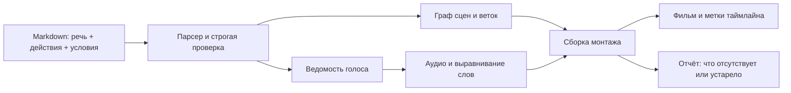

# Перенос актуальных хроник в фильм: сверка и план

18 ноября 2026 года. **Статус: аудит и проект реализации. Код фильма, сценарии, озвучка и опубликованный сайт в этой работе не изменялись.**

Текущий фильм заметно отстаёт от текста. Нужен перенос всей структуры V15 с пятью остановками, обновлённой речью и переставленными историями. Добавление четырёх игр поверх старого монтажа не синхронизирует выпуск.

Рекомендуемая основа: **один редактируемый сценарий Markdown с речью, действиями и ветками → проверяемый сборщик → данные фильма, задания на озвучку, субтитры и таймлайн**. Изображения и записи остаются отдельными файлами; текст хранит ссылки, условия и моменты их использования.

Наглядная схема управления: [кликабельный макет таймлайна](previews/chronicles-timeline-20261118.html). Это макет, а не новая версия фильма.

## 1. Что именно сверено

| Источник | Подтверждённое состояние |
| --- | --- |
| Co-Writer, живой документ | Открыта V15.1, 1450 строк; `dirty: false`. Снимок прочитан через `hub.py cowriter.read`, версия не изменилась за три страницы чтения. Текст совпал с файлом на диске после нормализации переносов строк. |
| [V15](VOICES_OF_PRODUCTION_V15_GUARDIANS.md) и [V15.1](VOICES_OF_PRODUCTION_V15_1_GUARDIANS.md) | Все 107 блоков между «ГОЛОС ЛОРДА» и «КОНЕЦ РЕПЛИКИ» имеют одинаковые ID и текст после удаления служебных тегов и нормализации пробелов. Это проверка размеченных блоков; обычное повествование вне них требует отдельного импорта. |
| Локальные `game.html` и `repo/dist/index.html` | Полностью одинаковые файлы, SHA-256 `57ba9da648c1a21d0d24b5e6d63fd317d2014e336f46dd63c31b58d6f41a05ad`. Это проверенный последний локальный билд; состояние GitHub Pages отдельно не проверялось. |
| `repo/src/storyData.ts` | 11 линейных сегментов старого фильма; сумма заданных длительностей 1647,15 с — 27:27. Это не хронометраж будущей V15 и не длительность выступления с Толевыми паузами. |
| Запуск локального билда | На экране подтверждены единственная игра с Горином, восемь клеток, штатная панель и шкала 27:27. Реального маскированного скриншота в этом игровом кадре нет. Полный просмотр всех сцен и прослушивание микса в аудит не входили. |

Машинные результаты и снимок версии: [audit.json](../../scratch/chronicles-build-audit-20261118/audit.json), [asset-inventory.json](../../scratch/chronicles-build-audit-20261118/asset-inventory.json), [ведомость 107 размеченных реплик](../../scratch/chronicles-build-audit-20261118/voice-inventory.json), [снимок Co-Writer](../../scratch/chronicles-build-audit-20261118/live-v15_1-snapshot.md).

Макет проверен в браузере: пауза сохраняет ожидание и блокирует продолжение, снятие паузы не запускает игру само; «Продолжить» переводит в игру, пробное завершение — в общую историю. Прямой переход к залу отмечает пропуски, игровая метка повторно открывает раунд. Это проверка макета управления, а не этих функций в фильме.

## 2. Разрыв между билдом и текстом

| Область | Сейчас в фильме | Что требуется по последнему тексту |
| --- | --- | --- |
| Главы | Старые акты и общий большой блок Клиентархов; старые названия и описания | Пролог/интро → пять функциональных залов с остановками → вердикт/награды → эпилог и управленческие директивы. Служебный банк реакций не является главой. |
| Повествование | Записи и субтитры старого монтажа; например, прежняя формулировка про показатель отсутствующих дат | Последняя речь V15, включая принятую редактуру про стопроцентную слаженность, хроно-реактор, сравнительные масштабы и короткие имена. Недостаточно заменить только экранный текст. |
| Живое слово | Нет пяти `HANDOFF` и ожиданий ведущего | Перед каждым залом: тема и шутка → голос заканчивается → неограниченное слово Толе → «Продолжить» → игра. |
| Игры | Один `WordGuessGate` из `protocol_gate.json`, жёстко связан с `act_3_timemachine` | Пять остановок с разными правилами; переиспользовать существующий буквенный ввод, но убрать привязку механики к одному старому акту и одному слову. |
| Перемещения историй | Сундук и Househunt ещё относятся к большому старому клиентскому акту; эпизод Павла находится в моторном блоке | Сундук — сразу после I-04; история Павла — после I-03; Househunt целиком — после I-02; объяснение Мамусина — после I-05. Серверная катастрофа и «oops» — в зале III. Переносить целиком с цитатами, не создавать повторов. |
| Представление людей | `speakerRole`, именные плашки и кадры управляются существующим монтажом | Чистый нейтральный портрет 2–4 с → имя и полный титул с временем чтения → голос и субтитры. Показанный человек и звучащий рассказчик — разные поля. |
| Скриншоты | Ключи Slack встроены в монтаж; игра с Горином показывает текстовый контекст | Отдельная маскированная копия на вопрос/ожидание/реакции; убрать при выходе из раунда. Полный оригинал — только на соответствующих словах истории. |
| Музыка | Секунды и настройки распределены между `MovieApp`, `narratorShotSequence`, `AmbientManager`, `PremiereAudioDirector` и `localStorage` | Перенести 155 событий партитуры V15.1 на состояния, реплики и речевые якоря. Старые секунды после новой записи не использовать. |
| Навигация | Точки старых актов; игра перехватывает вход в третий акт | Пять пар отдельных меток «Слово Толе I–V» / «Интерактив I–V» с повтором, понятным статусом и самостоятельными областями нажатия. |
| Спойлеры | В данных глав есть «Машина времени», «Мутация 22 ГБ и вердикт OOPS», «Робо-корова с лазерным выменем» | Проверить все пользовательские названия, подзаголовки и подсказки; оставить нейтральные темы и названия отсеков. Ответы, панчлайны и будущие форматы в навигацию не выводить. |

Точная последовательность уже согласована в [CHAPTER_HANDOFFS_TIMELINE.md](CHAPTER_HANDOFFS_TIMELINE.md); заново придумывать её не требуется.

| Перед залом | ID | Игра и правило | Обязательное продолжение |
| --- | --- | --- | --- |
| I | I-04 | «Миллионер», 3 ошибки; успех → реакция и «К хроникам», третья ошибка → COMMON и автоматический выход | Полная история звука сундука после любого исхода |
| II | I-01 | «Поле чудес», 8 клеток, 3 ошибки; сохранить банк реакций | История Горина без преждевременной разгадки |
| III | I-03 | ЧГК, один окончательный содержательный ответ; ошибочный → выбранный вердикт, раскрытие, сюжет. COMMON не вызывать | Полная история Павла до входа в зал III |
| IV | I-02 | Househunt: любой первый выбор раскрывает все четыре удалённые механики; ошибок и проигрышного сигнала нет | Полная история Househunt, затем зал IV |
| V | I-05 | «Поле чудес», 5 клеток, 3 ошибки; источник — синк | Исходное объяснение Мамусина, затем зал V |

После пятого зала шестой остановки нет. ID игр не обозначают порядок показа. Существующее общее правило «всем по три ошибки» нельзя распространить на I-02/I-03.

## 3. Что переиспользовать, подготовить и догенерировать

### Уже найдено

- Все **61 уникальный ключ изображения** из `[КАДР]` разрешаются в файлы, доступные действующему реестру ресурсов. Ещё один уникальный аргумент — `None`: это намеренный пустой кадр, его нужно явно преобразовать в `null`, а не искать картинку с таким именем.
- Все **16 уникальных ключей `[СЛАК]`** разрешаются в существующие изображения. Наличие файла не подтверждает его пригодность для маскированной игровой фазы или для нейтрального портрета.
- **146 MP3 телеигр**: 47 «Миллионера», 35 «Поля чудес», 64 ЧГК. Существование музыкальных файлов не означает готовность новых голосовых реплик.
- В действующем манифесте голоса — **31 клип**, все файлы найдены. С **33 блоками** нового сценария текст совпадает дословно после очистки служебной разметки и пробелов: несколько новых ID используют одну запись. Ещё **2 блока** отличаются только `…` / `...`, это кандидаты на тот же звук. Для **72 остальных** совпадение в этом манифесте не найдено.

Последние 72 — **список для проверки**, а не счёт на 72 новых генерации: два блока катастрофы могут совпасть со старой основной записью; часть новых ID может повторять другой новый текст. Обычные авторские абзацы вне 107 блоков тоже входят в полную ведомость озвучки.

### Ведомость подготовки

| Материал | Действие | Проверка готовности |
| --- | --- | --- |
| Пять передач слова, новые вопросы и реакции | Собрать все произносимые блоки; переиспользовать совпадения, записать недостающее тем же Geremy и согласованными настройками | ID → точный текст → рецепт голоса → файл → длительность → выравнивание; ни одна реакция не существует только в документе |
| Основной рассказ | Сравнить текст каждого смыслового фрагмента с реальным старым аудио. Неизменившиеся чистые фрагменты можно нарезать; изменённые — перезаписать вместе с достаточным контекстом | Нет слышимых скачков тембра/громкости/дыхания; речь и субтитры передают одну редакцию |
| I-04 | Производная `13_chest_egg_sound`: скрыть ответ и соседний преждевременный контекст | Не видны края букв, упоминания сундука и другие подсказки; полный исходник не мелькает при загрузке |
| I-01 | Производная `02_demoblil`: оставить автора, дату и допустимый контекст, запечь маску ответа | Скриншот читается с общего экрана и остаётся маскированным во всех реакциях |
| I-03 | Производная `04_claude_banned`: скрыть всю фразу-разгадку и соседние подсказки | Разрешённый показ на «внимание на экран»; полное изображение/сюжетный боди-хоррор появляются позднее |
| I-02 | Найти и подготовить подлинный контекст C9 Househunt, скрыв итоговую схему. Пока подходящей производной нет, использовать предусмотренный сценарием допустимый кадр Лорда | Не выдуман путь; нет ложной переписки, итогов вырезания или варианта «всё перечисленное» до выбора |
| I-05 | Оформить подлинную выдержку синка с подписью источника; скрыть все формы и повторы ответа | Не изображать Slack, не придумывать дату, не оставлять ответ в соседней строке |
| Портреты | Проверить существующие кадры на преждевременный предмет/фон. Догенерировать только те нейтральные портреты, которые невозможно получить допустимым кадрированием | До истории нет будущей кары, предмета или сюжетного события |
| Директивы COO | Сверстать две экранные карточки из терминального блока, сохранить исторические даты выпуска | Содержимое не попадает в TTS само по себе; решение об озвучивании должно быть явным |
| Субтитры | Выравнивать новые клипы по словам и исходному `voiceText`; хранить отдельную осознанную экранную версию при необходимости | Теги, ответы из служебного словаря и альтернативные ветки не прочитаны подряд |
| Музыка и SFX | Переиспользовать проверенную партитуру; назначить владельцев каналов и точные события | Нет двух фоновых систем, одновременно управляющих одним каналом; на живом слове Толи все звуки плеера выключены |

Новые UI-изображения и игровые производные складывать в `media/visual/generated/Gui/`, например `interactive-context/`; это предложенные пути, файлы пока не созданы. **Ничего не записывать и не копировать в `Fin`.** Генерация изображений нужна по результатам просмотра, массовый новый арт сейчас не обоснован.

### Неоднозначности сценария перед импортом

1. V15.1, строка 270: «Чистая экспозиция героя — 5 секунд» против общего правила 2–4 с. Для пробного монтажа принять 3 с чистого портрета, чтение карточки учитывать отдельно; исправление разметки провести отдельным согласованным изменением.
2. Часть «чистых портретов» уже содержит сюжетный реквизит: проверить не только имя героя, но и фон. Исключение для идентификации человека не разрешает будущие события.
3. Строки `[РЕЖИССУРА]` и `[ЭКРАН I-…]` написаны свободным языком. Они понятны постановщику, но не являются готовым контрактом для парсера. Требуется явная разметка условий, времени и слоёв.
4. В основной речи нет полного набора устойчивых ID. До импорта надо пометить все смысловые реплики, не меняя их слов.
5. Старые генераторы `repo/generate_story_data.py` и `tools/audio_pipeline/generate_story_data_v13.py` собирают старую модель/данные. `npm run build` сейчас **не компилирует V15.1**. Не запускать эти генераторы поверх нового монтажа.
6. Старый фильм содержит музыкальный финал/караоке. Сохранить его отдельным дополнительным узлом до решения о его месте в новом маршруте; отсутствие песни в тексте V15 не трактовать как разрешение удалить готовый материал.

## 4. Как хранить текст и действия вместе

### Один авторский источник

На этапе переноса V15 остаётся контрольным источником речи, V15.1 — источником режиссуры. После проверенного объединения единственным редактируемым мастером становится V15.1 в Markdown; читательская V15, JSON плеера, партитура и задания на запись автоматически экспортируются из него. Если сохранить прежние имена файлов, производные должны иметь заметную пометку «Сгенерировано, редактировать мастер».

Это уточняет старое предложение в `APP_CHANGE_PLAN.md` о структурированном JSON-мастере: по текущему запросу авторский источник должен оставаться текстом. Структура всё равно нужна, но она строится из Markdown и не правится независимо. Переключать роли файлов только после сравнения экспортированной речи с V15, сохранив исходники.



### Что обозначают команды

Сохранить знакомые `[КАДР]`, `[СЛАК]`, `[ЗАКРЫТЬ СЛАК]`, `[ПЕРСОНАЖ]`, `[ЗВУК]`, `[SFX]`, `[ИНТЕРАКТИВ]`. Добавить строгие параметры и отдельные якоря. Не исполнять произвольный код из текста и не угадывать действие по художественному предложению.

| Запись в сценарии | Смысл для фильма |
| --- | --- |
| Сцена и реплика с постоянным ID | Независимы от номера строки, положения в файле и порядкового номера главы |
| `[КАДР: ключ]` | Установить основной кадр; следующий кадр заменяет его |
| Чистый кадр и чтение карточки | Два явных монтажных интервала; настоящая задержка старта голоса, а не сдвиг одних субтитров |
| `[ЯКОРЬ: постоянный ID]` | Точное место между словами произносимого блока; разрешается по выравниванию аудио |
| `[СЛАК: ключ]` / закрытие по ID | Показать/убрать конкретный слой с собственным интервалом; закрытие не связано с окончанием случайной строки субтитров |
| `[ЗВУК]` | Файл/ключ, канал, старт/петля/остановка, громкость и fade; условие запуска задано явно |
| `[SFX]` | Однократный сигнал на событии; при произвольной перемотке в прошлое он не должен внезапно звучать |
| Интерактив | Формат, конкретная политика попыток, тексты/варианты, события выбранной ветки и единый узел продолжения |

Пример привязки речи и действий при импорте текущих тегов, а не уже поддерживаемой функции. Произносимая цитата взята из текущего сценария. После импорта монтажные параметры хранятся во встроенном конфиге, а метки в тексте ссылаются на их ID; итоговое сохранение описано в §5 и `DIRECTOR_MODE_SPEC.md`:

```text
[СЦЕНА: ROOM-I.DANIAL | название="Общий поток"]
[КАДР: retro_film_danial_iskakov_sapper_v1 | id=portrait.danial]
[ЧИСТЫЙ КАДР: 3s]
[ПЕРСОНАЖ: ДАНИАЛ ИСКАКОВ | Playable Developer • Кузнец Троичного Кода | id=card.danial]
[ЧТЕНИЕ КАРТОЧКИ: 3s]

[ГОЛОС ЛОРДА ROOM-I.DANIAL.INTRO]
Даниал Искаков описал свою задачу:
[КОНЕЦ РЕПЛИКИ]

[ГОЛОС ЛОРДА ROOM-I.DANIAL.QUOTE]
[ЯКОРЬ: danial.quote.in]
[СЛАК: 09_danial_3a_project | id=slack.danial]
«не над плееблом за 8сп работаю а над 3А проектом где любая деталь может привести к падению акций на пару миллиардов».
[ЯКОРЬ: danial.quote.out]
[ЗАКРЫТЬ СЛАК: id=slack.danial]
[КОНЕЦ РЕПЛИКИ]
```

Якорь перед словом означает его начало, якорь после фразы — конец предыдущего слова. Точное положение хранится как граница токенов в конкретной версии `voiceText`. Условные команды используют `on=…`, например `on=WAIT_I-04`, `on=I-04.ОШИБКА.A`, `on=EXIT_I-04`; набор событий строго перечислен в схеме. Текстовые условия вроде «когда станет страшно» остаются заметками до ручного уточнения.

При сложном показе звук/кадр можно привязать к `at=<anchorId>` и скрытие к `until=<anchorId>`. Сдвиг допускается только явно, с единицей времени и проверкой, что он не создаёт преждевременное раскрытие. Не искать фразу обычным `indexOf`: одинаковые слова встречаются несколько раз, а изменение текста должно потребовать перепроверки привязки.

### Текст → звук → точные моменты

1. Парсер выделяет **только речь** каждой реплики. Для текущего документа импортирует и явно размеченные клипы, и обычные абзацы под «Лорд»/«Голос хроник». Заголовки, ответы, директивы из служебного блока и инструкции экрану сами по себе речью не становятся.
2. Ведомость сохраняет `utteranceId`, `speakerId`, `voiceText`, `subtitleText`, хеш текста и рецепт озвучки. `subtitleText: null` наследует голос; пустая строка запрещена, видимость задаётся отдельно. `speakerId` — звучащий голос, `subjectId` — показанный человек.
3. Для неизменившегося текста и того же рецепта берётся существующий звук. Хеш включает голос, модель, настройки темпа/произношения и другие параметры синтеза. Дедупликация одинаковой речи позволяет нескольким ID ссылаться на один файл.
4. Выравнивание слов относится к конкретным хешам текста **и аудиофайла**. По нему рассчитываются времена якорей, субтитров и действий внутри речи. При отсутствии нужной границы экспорт не подставляет приблизительные секунды молча.
5. Изменение речи помечает устаревшими её запись, выравнивание и зависимые события. Изменение только подписи/титула не требует новой записи. Перестановка неизменённой сцены пересобирает порядок и общие позиции.
6. Политика вступления портрета добавляет отдельные интервалы монтажа до старта голоса. Живое ожидание не добавляет фиктивную тишину в MP3.

Физические файлы, хеши и word alignment хранятся в производных манифестах. Не нужно вклеивать аудио, изображения и тысячи времён слов в авторский Markdown.

## 5. Исполнение и обратная связь в редактор

Единица воспроизведения — узел: вступление, реплика, чистый кадр, живое ожидание, игра, общее продолжение, рассказ зала. Маршрут игровой остановки:

```text
previous → handoff_voice → waiting_for_host → game_intro/question
         → waiting_for_answer → selected_reaction → shared_continuation → room
```

У I-02/I-03 и игр с тремя ошибками свои переходы. Длительность музыки или истечение минуты в ЧГК не создаёт проигрыш. Пустой/некорректный ввод не должен случайно считаться окончательным содержательным ответом.

Пауза — независимый признак транспорта. «Ожидаем Толю» и «ждём ответ» — состояния маршрута; Play/пробел не обходят их. «Продолжить» в живом блоке запускает игру, кнопка включается только после реплики передачи. Клавиатурное нажатие на сфокусированной кнопке должно работать.

Для кадров, именных карточек, Slack и музыкальных петель вычислять **состояние в целевой позиции**, а не надеяться, что все предыдущие команды успели сработать. При seek заново получить допустимые видимые слои и позиции непрерывного аудио. Однократные SFX воспроизводятся только при обычном пересечении события; при восстановлении на паузе они молчат.

У каждого звука и слоя есть владелец `sceneId/nodeId` и срок жизни. Выход из сцены отменяет её загрузки, таймеры и звук. Поздний callback от закрытой игры не имеет права возобновить музыку. При двойном клике не появляются два раунда. Случайную реакцию фиксировать в состоянии раунда: пауза не должна выбирать другой вариант.

Каналы: VOICE, BASE, DREAD, PEACE, GAME_THINK, SFX; DREAD/PEACE взаимоисключаются. Для живого блока — тишина всех каналов плеера. Для COMMON — тишина музыкальных каналов. На остальных репликах — явное приглушение и восстановление действующей петли без старта с нуля. Запуск аудио должен учитывать браузерный пользовательский жест и ошибки загрузки; текстовая ветка не зависает на отсутствующем `ended`.

**Доработки Co-Writer проводить после работающего сборщика.** Сначала достаточно тех же тегов в обычном `.md`. Позже добавить команды «Показать кадр», «Вставить звук», «Показать/убрать скриншот», которые создают теги на месте курсора. У каждого действия — переход к соответствующей строке и обратный переход из предпросмотра.

На панели проверки показывать «нет файла», «озвучка устарела», «якорь потерян», «конфликт слоя», «не задан выход ветки». Двойной клик по реплике/действию открывает фильм рядом с этим местом. Сохранение текста не запускает платную генерацию автоматически: предпросмотр может использовать текстовые заглушки, производственная сборка требует готовых обязательных ресурсов.

### Полный режим режиссёра и текстовый конфиг

Уточнение пользователя от 18.11: **всю постановку редактировать визуально на дорожках, как в Premiere, и сохранять обратно в текстовый проект.** Подробный контракт интерфейса, операций и сохранения: [DIRECTOR_MODE_SPEC.md](DIRECTOR_MODE_SPEC.md).

Существующий `PremiereAudioDirector` расширяется на кадры, скриншоты, титулы, экранные элементы, голос, субтитры, музыку, SFX и игровые остановки. Предусмотреть библиотеку ресурсов, общий экран фильма, инспектор, перемещение/обрезку клипов, привязку к словам, fade/громкость/петли, монтаж веток, undo/redo и Ctrl+S. Неизвестные по длительности ожидания остаются узлами маршрута.

**Рабочее хранение:** один Markdown-мастер с речью, ссылками на события и встроенной секцией `chronicles-config` с JSON-параметрами монтажа. У каждого события постоянный ID; его параметры хранятся один раз в конфиге, рядом с речью стоит ссылка. Текстовый и визуальный редакторы работают с одной моделью. Это уточняет описанные выше теги: при импорте параметры старых тегов переходят в конфиг, дублирующий редактируемый набор не сохраняется.

Ctrl+S в локальном режиме подтверждённо записывает проект в файл через адаптер с проверкой версии. Если документ открыт в Co-Writer — только через API, `expectedVersion`, `editorVerified` и отдельное сохранение. В самостоятельном браузере без доступа к записи — явные экспорт/импорт полного текстового проекта. `localStorage` сохраняет черновик, но не заменяет файл. Конфликт не перезаписывает ручные изменения сценария.

## 6. Как показать интерактивы на таймлайне

Развить уже согласованное решение из `CHAPTER_HANDOFFS_TIMELINE.md`: **перед каждым залом две метки на одной границе записанного маршрута**, а не отдельные длинные отрезки ожидания.

- Верхний ряд: янтарная квадратная метка и «Слово Толе II». Нижний ряд: фиолетовый ромб и «Интерактив II». Общая вертикальная привязка к границе зала; небольшое экранное смещение нужно только для отдельных зон нажатия и не означает секунды.
- Пара меток имеет пять состояний: контур — впереди; обводка с текстом — текущая; «Ожидание» — живой блок; «В игре» — игровой блок; галочка — пройдено. При намеренном перескоке можно отдельно отмечать «Пропущено», не выдавая это за победу.
- Ни вопрос, ни ответ, ни название будущего формата, ни thumbnail с разгадкой не попадают в текст подсказки, `aria-label` или превью. Служебные ID не показывать зрителю.
- Янтарная метка заново воспроизводит передачу и приводит к живому слову. Фиолетовая явно начинает новый раунд соответствующей игры. Возврат ползунком в уже пройденный зал не навязывает игру повторно.
- Последовательное воспроизведение пересекает непройденную остановку и выполняет весь маршрут. Прямой переход к записанному фрагменту — сознательная навигация: закрывает активную игру и её звук, отмечает перескоченные остановки как пропущенные. Он не должен тайно запускать цепочку всех пропущенных игр. Прямой переход к игровому маркеру всегда запускает эту игру.
- Пройденность хранится для текущего просмотра вместе с версией сценария. «Начать заново» сбрасывает её; повтор отдельной игры не сбрасывает весь фильм. Явный повтор не означает, что нужно повторно слушать общую историю дважды подряд.
- В компактном режиме свернуть подписи до двух различимых значков и номера зала; по фокусу/нажатию показывать пояснение. На узком экране разрешить прокрутку/список глав вместо наложения десяти мелких кнопок.

**Время:** основная шкала показывает положение в записанном маршруте, рассчитанное после озвучки. Пять живых ожиданий и время ввода не растягивают её. На остановке курсор остаётся на границе, рядом «Слово Толе · Ожидание» или «Интерактив · В игре». Для голоса вопроса и реакций — локальный прогресс текущего клипа; для длительности выступления при необходимости — отдельный счётчик сессии. Общую длительность живого показа заранее не обещать. Хронометраж веток не складывать так, будто в одном прохождении звучат все альтернативы.

Области нажатия каждой метки — не меньше 44×44 CSS px как начальная настройка прототипа; проверить на реальном WS-68 и общем экране. Цвет поддерживается формой, текстом и фокусом клавиатуры. Завершённая кнопка в макете иллюстрирует статус, а не новую игровую механику.

## 7. Порядок реализации

| Этап | Что сделать | Проверяемый результат |
| --- | --- | --- |
| 0. Зафиксировать основу | Сохранить снимки текста/билда и экспортировать используемые монтажные настройки браузера. Подготовить карту `старый акт/фрагмент → новый зал/узел` | Известны исходная версия и спорные места. `game-previous.html` остаётся резервом; текущие пользовательские изменения не затёрты |
| 1. Контракт и импорт | Описать версию синтаксиса и встроенного конфига; дать ID репликам/событиям; перевести свободные действия в общую модель; объединить V15/V15.1 без переписывания речи | AST/граф, отчёт ресурсов, безопасный голосовой экспорт и чтение/сохранение текстового проекта; все 107 блоков и обычный рассказ учтены ровно один раз |
| 2. Один полный проход | Собрать зал II с I-01: передача → Толя → игра → история; две метки; редактирование кадра/Slack/звука на дорожках и сохранение конфига | Работают pause/seek/CC/громкость, 3 ошибки, повтор и чистый вход. После сохранения и открытия в чистом браузере монтаж совпадает |
| 3. Медиа и новый монтаж | Полная ведомость озвучки, повторное использование/нарезка/дозапись; alignment; пять контекстов; проверка портретов; события партитуры | Нет устаревшей речи и незаполненных обязательных ключей; голос совпадает с текстом; тайминги вычислены из новых записей |
| 4. Остальные механики и маршрут | Два режима «Миллионера» с разными правилами, одноответный ЧГК, параметризованное второе «Поле»; пять залов, перенесённые истории, вердикт и директивы | Каждый исход сходится в нужном общем узле, важные факты не зависят от победы. Нет шестой игры и повторов перенесённых историй |
| 5. Все метки и полный редактор | Пять пар меток и навигация; все дорожки режима режиссёра, инспектор, ресурсы, ветки, undo/redo и обмен текстом/конфигом | Любая постановка выпуска редактируется визуально и сохраняется в текст; нет независимого монтажа только в браузере |
| 6. Приёмка и сборка | Проверки типов, графа, ресурсов, воспроизведения и визуальных канонов; собрать кандидат; проверить обе версии презентации | `npm run typecheck`, `npm run build`, локальный просмотр через сервер с byte ranges; публикация отдельным следующим действием |

Новые предполагаемые модули: `script/schema`, `script/parser`, `script/compiler`, `runtime/PlaybackController`, `runtime/TimelineReducer`, `interactive/InteractiveController`, `interactive/ChoiceGate`, `interactive/FreeAnswerGate`, `timeline/StopMarkers`. Это план разделения ответственности, не требование немедленно переписать весь `MovieApp.ts`.

Существующие точки подключения: `storyData.ts` — адаптер к сгенерированным сценам; `narratorShotSequence.ts` — перенос событий кадра/Slack; `Subtitles.ts` — точные интервалы и независимость карточек; `WordGuessGate.ts` — параметры сценария вместо одного JSON; `AmbientManager`/`PremiereAudioDirector` — единое владение звуком; `assetsManager.ts` — проверенный реестр. Новый сборщик сначала выдаёт совместимые данные, затем старые дублирующие источники отключаются по одному.

## 8. Приёмка, которая действительно доказывает перенос

1. Из мастера экспортируются последняя речь и все варианты без служебных строк; сравнение с контрольной V15 не обнаруживает потери цитат и обычного повествования. Заголовки, директивы и условные ветки не оказываются линейной озвучкой.
2. В графе ровно пять живых остановок и пять игр в согласованном порядке. Для каждого результата проверены общий узел, следующий зал и отсутствие недостижимого/зацикленного выхода.
3. Третья ошибка I-04/I-01/I-05 вызывает COMMON один раз и продолжение. I-02 не имеет ошибки. ЧГК после одного содержательного ответа не открывает новый ввод. Пустой ввод и двойной Enter не создают два результата.
4. Маскированные изображения сохраняются на протяжении вопроса и ошибок, затем закрываются; оригинал не мелькает на загрузке/сбое. I-05 честно обозначен синком. Поле, кнопки и субтитры доступны на общем экране.
5. Портрет открывается чистым 2–4 с, затем читается полный титул, потом звучит речь. Фон не спойлерит будущие события. В субтитрах нет прежней реплики в тишине; текущий fallback `Subtitles.syncToTime`, выбирающий первую/последнюю/предыдущую реплику вне точного интервала, заменён для новых сцен.
6. Проверены пауза внутри речи/тишины/ожидания, seek до/внутрь/после игры, повтор меткой, возврат назад, новый просмотр, потеря фокуса и ошибка загрузки аудио. Старые callbacks не возвращают звук. Все статусы и настройки CC/громкости сохраняются предсказуемо.
7. Перестановка сцены сохраняет её ID и действия; правка реплики инвалидирует только связанные медиа/якоря; замена экранного титула не требует TTS. Компиляция дважды из одинаковых входов даёт одинаковый результат.
8. Нет неразрешённых ассетов, неоднозначных якорей и тихих подмен по приблизительным секундам. `build-manifest` фиксирует `scriptHash`, версию компилятора и хеши ресурсов; в служебной панели видно, из какого текста собран фильм.
9. После сборки сделаны визуальная проверка пяти входов и директив, проверка обеих версий в презентации и прослушивание переходов/ducking. Одно совпадение файлов или успешный TypeScript не считается полноценной приёмкой фильма.
10. Режиссёр меняет кадр, границы скриншота, титр, звук и положение интерактива, сохраняет проект и открывает его без прежнего браузерного кэша: все параметры восстановлены. Ручная правка конфига отображается на тех же дорожках; сохранение не переписывает утверждённые реплики и заметки.

### Границы этой сверки

Проверены локальная сборка, основные источники и ресурсы; полная пословная транскрипция всех старых MP3 не выполнялась. Отчёт переиспользования покрывает 107 явных голосовых блоков и текущий манифест игры, а не всю библиотеку основной озвучки. Точный бюджет новых клипов и длительность выпуска определяются после полной ведомости.

Внешняя проверка через Gemini Pro Pool была подготовлена по проектным инструкциям, но автоматический контроль запретил отправку внутренних документов и кода без отдельного согласия на этот набор данных. Отправка не выполнялась; выводы этого плана получены локальной проверкой.
